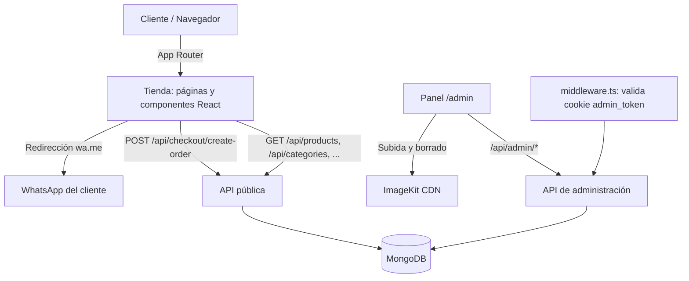

# Arquitectura Técnica: Catálogo E-Commerce The Point / Technical Architecture: The Point E-Commerce Catalog

> Este documento describe el sistema **actual**. El modelo original de calzado (tipos, géneros y talles fijos, `sizesStock`) fue reemplazado por categorías, atributos y variantes. El plan original se conserva en [planificacion.md](planificacion.md) como referencia histórica.

---

# 🇪🇸 VERSIÓN EN ESPAÑOL

## 1. RESUMEN DE ARQUITECTURA TÉCNICA

| Capa | Tecnología |
| --- | --- |
| Framework fullstack | Next.js 16 (App Router, Route Handlers) con React 19 y TypeScript |
| Estilos | Tailwind CSS 4, íconos `lucide-react`, notificaciones `sonner` |
| Base de datos | MongoDB con Mongoose 9 |
| Validación | Zod 4 (`src/schemas`: atributos y categorías) |
| Autenticación del panel | JWT firmado con `jose` (HS256) en cookie HttpOnly; contraseñas con `bcryptjs` |
| Imágenes | ImageKit (solo se guardan las URLs y el `fileId` en la base) |
| Mensajería | Redirección `wa.me` (WhatsApp) con el resumen del pedido |
| Sistema de diseño | [DESIGN.md](DESIGN.md) |



---

## 2. ESTRUCTURA DEL CÓDIGO

```text
src/
├── app/
│   ├── page.tsx                  Tienda: catálogo, filtros, carrito y checkout
│   ├── admin/                    Panel: pedidos, POS, productos, stock, categorías,
│   │                             atributos, marcas, promociones, reportes,
│   │                             contabilidad, usuarios y ajustes
│   └── api/                      Route Handlers (públicos y /api/admin/*)
├── components/
│   ├── layout/                   Header, Footer, StoreLayoutWrapper
│   ├── products/                 ProductCard, ProductGrid, FilterBar, ProductDetailModal
│   ├── cart/ · checkout/         CartDrawer · CheckoutModal y pasos
│   ├── admin/                    AdminNav, ProductForm, OrderDetailModal, OrderEditModal, ...
│   └── common/ · ui/ · home/     SearchBar, Alert/sonner, PromoCarousel
├── context/                      CartContext, SettingsContext
├── hooks/                        useStoreCategories
├── lib/                          Lógica de dominio y utilidades (ver sección 4)
├── models/                       Modelos Mongoose
├── schemas/                      Esquemas Zod
├── utils/                        formatCurrency, whatsapp
└── middleware.ts                 Protección de /admin y /api/admin
scripts/                          seed.ts, wipe-data.ts
docs/                             Esta documentación
```

---

## 3. MODELO DE DATOS (MONGODB / MONGOOSE)

Colecciones: `brands`, `categories`, `attributes`, `products`, `orders`, `salesrecords`, `promotions`, `expenses`, `users`, `settings` y `counters` (este último sin uso actual).

### 3.1 `categories`
```typescript
interface ICategory {
  name: string;
  slug: string;                          // único
  parentId?: Types.ObjectId | null;      // null en los rubros (raíz)
  ancestors: Types.ObjectId[];           // [raíz, ..., padre]; derivado
  variantAxes: string[];                 // keys de atributos select que generan variantes
  imageAxis?: string;                    // eje que agrupa imágenes
  specAttributes: { key: string; required: boolean }[]; // ficha técnica
  order: number;
  active: boolean;
}
// Índices: { parentId: 1, order: 1 }, { ancestors: 1 }, { active: 1, order: 1 }
```

### 3.2 `attributes`
```typescript
interface IAttribute {
  key: string;                           // único, inmutable, minúsculas y "_"
  label: string;
  type: 'select' | 'text' | 'number' | 'boolean';
  options: {
    value: string;                       // slug inmutable
    label: string;                       // editable
    order: number;
    hex?: string;                        // solo colores
    active: boolean;                     // se desactiva en vez de borrarse
  }[];
  unit?: string;                         // ej: "ml"
  filterable: boolean;
}
```
El género es el atributo `genero`; no existe un modelo de géneros ni de tipos.

### 3.3 `products`
```typescript
interface IVariant {
  _id: Types.ObjectId;                   // estable al editar el producto
  sku: string;                           // se guarda en mayúsculas
  name?: string;
  options: { key: string; value: string }[];
  retailPrice: number;
  wholesalePrice?: number;
  stock: number;
  active: boolean;
}

interface IProduct {
  name: string;
  slug?: string;
  description: string;
  categoryId?: Types.ObjectId;
  categoryAncestors?: Types.ObjectId[];  // derivado de la categoría
  brandId?: Types.ObjectId;
  active: boolean;
  isClearance?: boolean;
  specs?: { key: string; value: string | number | boolean }[];
  wholesale?: { enabled: boolean; minQty?: number };
  images: { url: string; fileId?: string; isPrincipal: boolean; position: number; axisValue?: string }[];
  variants?: IVariant[];

  // Derivados (se recalculan al guardar)
  priceRange?: { min: number; max: number };
  totalStock?: number;
  hasWholesale?: boolean;

  // Campos de compatibilidad a nivel producto
  price?: number; retailPrice?: number; wholesalePrice?: number; stock?: number;
}
// Índices: { active, categoryAncestors, priceRange.min }, { active, brandId }, { variants.sku },
//          { slug } único y disperso, { variants.options.key, variants.options.value }, texto en name y description
```

### 3.4 `orders`
```typescript
interface IOrderItem {
  productId: Types.ObjectId;
  variantId?: Types.ObjectId;
  sku?: string;
  name: string;
  image?: string;
  variantLabel?: string;
  variantName?: string;
  qty: number;
  appliedPriceType: 'retail' | 'wholesale' | 'custom';
  unitPrice: number;                     // foto del precio al momento de la venta
  subtotal: number;
}

interface IOrder {
  orderNumber: string;                   // único, "PED-AAAA-NNNNxx"
  origin: 'web' | 'admin_direct';
  guest: { name: string; lastName: string; phone: string };
  items: IOrderItem[];
  subtotal: number;
  discount: number;
  total: number;                         // subtotal - discount
  paymentMethod: 'transferencia' | 'efectivo' | 'tarjeta' | 'otro';
  status: 'pendiente' | 'autorizado' | 'cancelado'
        | 'confirmada' | 'completada' | 'cancelada';   // los tres últimos son heredados
  notes?: string;
  cancelReason?: string;
}
// Índices: { orderNumber } único, { status, createdAt }, { origin, createdAt }
```

### 3.5 Otras colecciones
- **`salesrecords`:** `orderId` (único), `orderNumber`, `confirmationDate`, `recordedPaymentMethod`, `appliedDiscountNote`, `finalTotal`.
- **`brands`:** `name` único.
- **`promotions`:** `title`, `description`, `imageUrl`, `active`, `order`, `startDate`, `endDate`.
- **`expenses`:** `concept`, `category` (`mercaderia`, `logistica`, `servicios`, `marketing`, `alquiler`, `sueldos`, `otros`), `amount`, `paymentMethod`, `date`, `notes`.
- **`users`:** `username` único, `passwordHash`, `name`, `email`, `role` (`superadmin` | `admin` | `seller`), `active`.
- **`settings`:** documento único (identidad y contacto, SEO, datos bancarios, `minStockAlert`, `wholesaleMinPairs`, `shippingInfo`, `enableGenders`).

---

## 4. LÓGICA DE DOMINIO (`src/lib`)

| Módulo | Responsabilidad |
| --- | --- |
| `derived.ts` | Calcula `priceRange`, `totalStock` y `hasWholesale` a partir de las variantes activas. |
| `variants.ts` | Genera combinaciones de variantes a partir de los ejes de la categoría, SKUs y etiquetas. |
| `stock.ts` | Convierte variantes en filas de stock editables y suma las unidades de las variantes activas. |
| `categoryTree.ts` | Arma el árbol de categorías (rubros y sus categorías) y los enlaces `?categoryId=`. |
| `categoryFilter.ts` | Condición de Mongo para filtrar por una categoría **y sus descendientes** (`categoryId` o `categoryAncestors`). |
| `genderFilter.ts` | Condición de Mongo por la ficha técnica `genero` (acepta el slug o la etiqueta) y opciones activas del atributo. |
| `pricing.ts` | Motor de precios puro (sin integrar todavía; ver deuda técnica). |
| `jwt.ts` · `auth.ts` | Firma y verificación de la sesión del panel y chequeo de rol. |
| `db.ts` · `imagekit.ts` · `api-client.ts` | Conexión cacheada a MongoDB, cliente de ImageKit y cliente HTTP del frontend. |

Hook `useStoreCategories`: una única consulta a `/api/categories`, compartida entre el encabezado y el pie.

---

## 5. ENDPOINTS DE API

Respuesta estándar: `{ ok: true, data, ... }` o `{ ok: false, error, message }`.

### 5.1 Públicos
| Método | Ruta | Descripción |
| --- | --- | --- |
| GET | `/api/products` | Productos activos. Query: `brandId`, `categoryId` (lista separada por comas; incluye descendientes), `gender`, `search`, `clearance`, `wholesale`, `sort` (`price_asc` \| `price_desc`), `page`, `limit`. Devuelve `totalStock`, `isOutOfStock` y `pagination`. |
| GET | `/api/categories` | Categorías activas ordenadas (alimentan menú, pie y filtros). |
| GET | `/api/brands` | Marcas. |
| GET | `/api/catalog/available-filters` | Opciones activas del atributo `genero`. |
| GET | `/api/promotions` | Promociones del carrusel. |
| GET | `/api/settings` | Ajustes públicos de la tienda. |
| GET | `/api/health` | Estado del servicio. |
| POST | `/api/checkout/create-order` | Crea un pedido `pendiente`. **No descuenta stock.** |

**`POST /api/checkout/create-order`**
```json
{
  "guest": { "name": "Juan", "lastName": "Pérez", "phone": "3815218630" },
  "paymentMethod": "transferencia",
  "items": [
    { "productId": "66b1...", "variantId": "66b2...", "qty": 2 }
  ]
}
```
El servidor ignora los precios del cliente y, para cada ítem: resuelve la variante (por `variantId`, `sku` o `variantName`), verifica el stock disponible (`409 INSUFFICIENT_STOCK` si no alcanza), aplica el precio minorista o mayorista según las reglas del producto y crea la orden con `origin: "web"`. Respuesta `201` con `orderId`, `orderNumber`, `subtotal`, `discount` y `total`.

### 5.2 Administración (`/api/admin/*`, requieren sesión)
| Recurso | Métodos | Notas |
| --- | --- | --- |
| `auth/login`, `auth/logout`, `auth/me` | POST, POST, GET | Sesión por cookie `admin_token`. |
| `products`, `products/[id]` | GET, POST, PUT, DELETE · GET | Alta y edición con variantes; el PUT conserva el `_id` de las variantes existentes. |
| `products/[id]/stock` | PATCH | Ajuste de stock por variante (`variantId` o `sku`). |
| `stock` | GET, PUT | Reporte por producto y variante, y ajuste de una variante (`productId`, `variantId`, `newStock`). |
| `categories`, `categories/[id]` | GET, POST · GET, PUT, DELETE | No permite cambiar los ejes de una categoría con productos ni eliminarla; al moverla actualiza los ancestros de sus productos. |
| `attributes`, `attributes/[id]` | GET, POST · GET, PUT, DELETE | Atributos y opciones. No permite quitar una opción usada en variantes o en la ficha técnica de algún producto. |
| `brands`, `promotions`, `expenses` | CRUD | Expenses: GET, POST, DELETE. |
| `orders` | GET, PUT | El GET lista y filtra pedidos; el PUT (cambio de estado `completada`/`cancelada`) es un flujo heredado que el panel no usa. |
| `orders/[id]` | GET, PUT, PATCH | PUT edita un pedido pendiente y conserva el vínculo con cada variante; PATCH con `{ action: "cancel" }` cancela. |
| `orders/[id]/authorize` | POST | Autoriza: verifica stock, descuenta por variante, pasa a `autorizado` y crea el registro de venta. |
| `sales/create-direct` | POST | Venta del POS: crea el pedido `autorizado` y descuenta el stock al instante. |
| `reports`, `accounting` | GET | Métricas de ventas; libro mensual de ingresos y gastos (`month`, `year`). |
| `users`, `settings` | CRUD · GET, PUT | Gestión de usuarios (con reglas de `superadmin`) y de ajustes. |
| `imagekit/upload`, `imagekit/delete` | POST · DELETE | Imágenes en el CDN. |

**Autorización de pedidos.** Si MongoDB corre como *replica set*, el descuento de stock, el cambio de estado y el registro de venta se ejecutan en una transacción; en un servidor standalone se descuenta ítem por ítem y, ante un error, se revierte manualmente lo descontado.

---

## 6. SEGURIDAD Y SESIÓN

- `middleware.ts` protege `/admin/*` (redirige al login) y `/api/admin/*` (responde `401`), excepto el login y el logout.
- El login valida usuario y contraseña (`bcryptjs`) y emite un JWT HS256 de 7 días en la cookie `admin_token` (`httpOnly`, `sameSite: lax`, `secure` en producción).
- Solo los roles `superadmin` y `admin` son aceptados; el rol `seller` existe en el modelo pero no tiene acceso.
- Un `superadmin` es el único que crea o edita a otro `superadmin`, y se protege al último `superadmin` activo.
- `pnpm seed` crea un `superadmin` inicial: **cambiá sus credenciales** antes de exponer el sistema.

---

## 7. FRONTEND

- **Estado del cliente:** `CartContext` (carrito en `localStorage`, clave `cj_store_cart_v1`, cálculo de precio mayorista) y `SettingsContext` (ajustes públicos).
- **Navegación por categorías:** el encabezado (rubros con desplegable) y el pie (columna *Categorías*) se arman con `useStoreCategories`; sus enlaces abren `/?categoryId=<id>#catalogo`, que la página principal convierte en filtro.
- **Filtros del catálogo:** marca, categoría (jerárquica), género (si está habilitado) y orden por precio, enviados a `/api/products`.
- **WhatsApp:** `utils/whatsapp.ts` arma el mensaje del pedido (con la variante de cada ítem y el alias bancario); el detalle de pedido del panel arma un mensaje al cliente con el nombre de la tienda.
- **Tema:** encabezado y pie oscuros; contenido principal claro (ver [DESIGN.md](DESIGN.md)).

---

## 8. VARIABLES DE ENTORNO Y SCRIPTS

Variables leídas por el código (archivo `.env`, o el indicado en `ENV_FILE` para los scripts):

```env
# MongoDB
MONGODB_URI=mongodb://localhost:27017/cj-store

# Firma de la sesión del panel (obligatoria en producción)
NEXTAUTH_SECRET=<cadena larga y aleatoria>

# ImageKit
NEXT_PUBLIC_IMAGEKIT_URL_ENDPOINT=https://ik.imagekit.io/<tu_cuenta>
NEXT_PUBLIC_IMAGEKIT_PUBLIC_KEY=public_...
IMAGEKIT_PRIVATE_KEY=private_...
```

La identidad de la tienda, el WhatsApp y los datos bancarios **no** se configuran por variables de entorno: se editan en *Ajustes* del panel y se guardan en la colección `settings`.

| Script | Acción |
| --- | --- |
| `pnpm dev` · `build` · `start` · `lint` | Desarrollo, compilación, ejecución y linter. |
| `pnpm seed` · `seed:prod` | Vacía las colecciones y crea el `superadmin` inicial (`seed:prod` usa `.env.prod`). **Destructivo.** |
| `pnpm wipe:data` | Vacía todas las colecciones excepto `users`. **Destructivo.** |

---

## 9. DEUDA TÉCNICA CONOCIDA

Críticos
1. **Secreto JWT por defecto:** `src/lib/jwt.ts` usa una cadena fija si falta `NEXTAUTH_SECRET`. En un despliegue sin esa variable, cualquiera podría fabricar un token de administrador. Debería fallar al arrancar si no está definida.

Inconsistencias de negocio
2. **Umbral mayorista global fijo:** la constante `5` está repetida en `CartContext`, `CartDrawer`, `create-order`, `create-direct` y el POS. El ajuste `wholesaleMinPairs` se guarda pero no se aplica.
3. **`minQty` y `minUnits`:** el producto guarda `wholesale.minQty`, pero el carrito del cliente lee `wholesale.minUnits` (siempre vacío), por lo que ignora el umbral por producto; el servidor sí lo respeta.
4. **Cancelación sin validación de estado:** `PATCH /api/admin/orders/[id]` no verifica que el pedido esté pendiente ni repone stock si estaba autorizado. El panel solo ofrece cancelar pedidos pendientes.
5. **Flujo heredado:** `PUT /api/admin/orders` (estados `completada`/`cancelada`) no lo usa el panel y ubica variantes solo por nombre.

Código sin uso o redundante
6. `src/lib/pricing.ts` (motor de precios puro) y el modelo `Counter` no están integrados; el número de pedido sale de la cantidad de pedidos más un sufijo aleatorio, que no garantiza unicidad.
7. Los campos a nivel producto `stock`, `retailPrice`, `wholesalePrice`, `price` y `totalStock` pueden quedar desfasados respecto de las variantes (las lecturas recalculan desde las variantes).
8. El rol `seller` no tiene acceso al panel.

Calidad
9. ESLint reporta advertencias y errores previos (por ejemplo `setState` dentro de efectos y usos de `any`) y no hay pruebas automatizadas.

---
---

# 🇬🇧 ENGLISH VERSION

> This document describes the **current** system. The original footwear model (fixed types, genders and sizes, `sizesStock`) was replaced by categories, attributes and variants. The original plan is kept in [planificacion.md](planificacion.md) as a historical reference.

## 1. TECHNICAL ARCHITECTURE SUMMARY

- **Fullstack framework:** Next.js 16 (App Router, Route Handlers), React 19, TypeScript.
- **Styling and UI:** Tailwind CSS 4, `lucide-react`, `sonner`.
- **Database:** MongoDB with Mongoose 9.
- **Validation:** Zod 4 (`src/schemas`).
- **Admin authentication:** HS256 JWT (`jose`) in an HttpOnly cookie; passwords hashed with `bcryptjs`.
- **Images:** ImageKit (only URLs and `fileId` are stored).
- **Messaging:** `wa.me` redirection with the order summary.
- **Design system:** [DESIGN.md](DESIGN.md).

## 2. CODE LAYOUT

`src/app` (storefront, `admin/` panel, `api/` route handlers), `src/components` (layout, products, cart, checkout, admin, common), `src/context` (`CartContext`, `SettingsContext`), `src/hooks` (`useStoreCategories`), `src/lib` (domain logic), `src/models` (Mongoose), `src/schemas` (Zod), `src/utils`, `src/middleware.ts`, `scripts/` (`seed.ts`, `wipe-data.ts`).

## 3. DATA MODEL

Collections: `brands`, `categories`, `attributes`, `products`, `orders`, `salesrecords`, `promotions`, `expenses`, `users`, `settings` and `counters` (currently unused).

- **`categories`:** `name`, unique `slug`, `parentId` (null for rubros), derived `ancestors`, `variantAxes`, `imageAxis`, `specAttributes`, `order`, `active`.
- **`attributes`:** immutable unique `key`, `label`, `type`, `options { value, label, order, hex, active }`, `unit`, `filterable`. Gender is the `genero` attribute; there are no gender or type models.
- **`products`:** `name`, `slug`, `description`, `categoryId` and derived `categoryAncestors`, `brandId`, `active`, `isClearance`, `specs`, `wholesale { enabled, minQty }`, `images`, `variants` and derived `priceRange`, `totalStock`, `hasWholesale`. A variant has `_id` (stable across edits), `sku`, optional `name`, `options`, `retailPrice`, optional `wholesalePrice`, `stock` and `active`. Product-level `price`, `retailPrice`, `wholesalePrice` and `stock` are compatibility fields.
- **`orders`:** `orderNumber` (`PED-YYYY-NNNNxx`), `origin`, `guest`, `items` (`productId`, `variantId`, `sku`, `variantLabel`, `qty`, `appliedPriceType`, `unitPrice`, `subtotal`), `subtotal`, `discount`, `total`, `paymentMethod`, `status` (`pendiente` | `autorizado` | `cancelado`; `confirmada`, `completada` and `cancelada` are legacy), `notes`.
- **Others:** `salesrecords`, `brands`, `promotions`, `expenses`, `users` (roles `superadmin` | `admin` | `seller`) and a single `settings` document.

## 4. DOMAIN LOGIC (`src/lib`)

`derived.ts` (price range, total stock and wholesale flag from active variants), `variants.ts` (variant combinations, SKUs, labels), `stock.ts` (stock rows from variants), `categoryTree.ts` (category tree and links), `categoryFilter.ts` (category and descendants filter), `genderFilter.ts` (`genero` spec filter and active options), `pricing.ts` (pure pricing engine, not wired yet), `jwt.ts` and `auth.ts` (session), plus `db.ts`, `imagekit.ts` and `api-client.ts`.

## 5. API ENDPOINTS

**Public:** `GET /api/products` (query: `brandId`, `categoryId` including descendants, `gender`, `search`, `clearance`, `wholesale`, `sort`, `page`, `limit`), `GET /api/categories`, `GET /api/brands`, `GET /api/catalog/available-filters` (active `genero` options), `GET /api/promotions`, `GET /api/settings`, `GET /api/health` and `POST /api/checkout/create-order`.

`POST /api/checkout/create-order` ignores client prices: it resolves each variant (`variantId`, `sku` or `variantName`), checks stock (`409 INSUFFICIENT_STOCK`), applies retail or wholesale pricing and creates a `pendiente` order **without touching stock**.

**Admin (`/api/admin/*`, session required):** auth (`login`, `logout`, `me`), `products` (+ `[id]` and `[id]/stock`), `stock`, `categories`, `attributes`, `brands`, `promotions`, `expenses`, `orders` (list; `[id]` GET/PUT/PATCH; `[id]/authorize`), `sales/create-direct`, `reports`, `accounting`, `users`, `settings` and `imagekit/upload|delete`.

- `PUT /api/admin/orders/:id` edits a pending order and **keeps the link to each variant**; it does not touch stock.
- `POST /api/admin/orders/:id/authorize` verifies stock, decrements it per variant, sets `autorizado` and creates the sales record. On a MongoDB replica set it runs in a transaction; on a standalone server it decrements item by item and rolls back manually on error.
- `POST /api/admin/sales/create-direct` creates an `autorizado` order and decrements stock immediately.
- `PUT /api/admin/products` preserves the `_id` of existing variants.

## 6. SECURITY

`middleware.ts` protects `/admin/*` (redirect) and `/api/admin/*` (`401`). Login issues a 7-day HS256 JWT in the `admin_token` cookie (`httpOnly`, `sameSite: lax`, `secure` in production). Only `superadmin` and `admin` are accepted; `seller` has no access. Only a `superadmin` manages other superadmins and the last active one is protected. `pnpm seed` creates an initial `superadmin`: **change its credentials** before exposing the system.

## 7. FRONTEND

`CartContext` keeps the cart in `localStorage` (`cj_store_cart_v1`) and computes wholesale pricing. The header (rubros with a dropdown) and the footer (*Categorías* column) are built from `useStoreCategories`; their links open `/?categoryId=<id>#catalogo`. Catalog filters are brand, hierarchical category, gender (when enabled) and price sorting. WhatsApp messages include each item's variant. Header and footer are dark; the main content is light.

## 8. ENVIRONMENT VARIABLES AND SCRIPTS

`MONGODB_URI`, `NEXTAUTH_SECRET` (required in production), `NEXT_PUBLIC_IMAGEKIT_URL_ENDPOINT`, `NEXT_PUBLIC_IMAGEKIT_PUBLIC_KEY`, `IMAGEKIT_PRIVATE_KEY`; scripts accept `ENV_FILE`. Store identity, WhatsApp and bank data live in the `settings` collection, edited from the admin *Ajustes* page. Scripts: `dev`, `build`, `start`, `lint`, `seed` and `seed:prod` (destructive: empty the collections and create the initial `superadmin`), `wipe:data` (empties everything except `users`).

## 9. KNOWN TECHNICAL DEBT

1. **Critical:** `src/lib/jwt.ts` falls back to a hardcoded secret when `NEXTAUTH_SECRET` is missing; a deployment without it lets anyone forge an admin token. It should fail at startup instead.
2. The global wholesale threshold (`5`) is hardcoded in `CartContext`, `CartDrawer`, `create-order`, `create-direct` and the POS; the admin setting `wholesaleMinPairs` is stored but not applied.
3. The product stores `wholesale.minQty` while the client cart reads `wholesale.minUnits`, so the per-product threshold is ignored in the cart (the server honors it).
4. `PATCH /api/admin/orders/:id` (cancel) does not check that the order is pending and does not restore stock for authorized orders; the panel only offers it for pending orders.
5. `PUT /api/admin/orders` (legacy `completada`/`cancelada` flow) is unused by the panel and matches variants by name only.
6. `src/lib/pricing.ts` and the `Counter` model are unused; order numbers come from the order count plus a random suffix, which does not guarantee uniqueness.
7. Product-level `stock`, prices and `totalStock` can drift from the variants (reads recompute from variants); the `seller` role has no panel access.
8. ESLint reports pre-existing issues (for example `setState` inside effects and `any` usage) and there are no automated tests.
